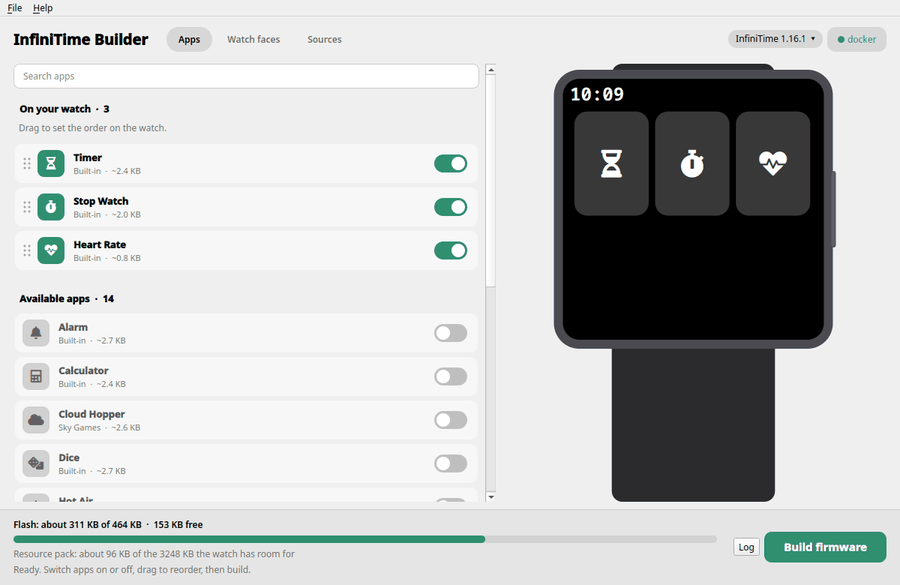

# InfiniTime Builder

Build your own [InfiniTime](https://github.com/InfiniTimeOrg/InfiniTime) firmware for the PineTime
without forking or touching code:



- **Switch apps and watch faces on or off** and drag them into the order you want in the
  launcher, with a live preview of the watch screen. A fresh install starts with the bare minimum:
  the Digital and Analog faces, plus Timer, Stopwatch and Heart Rate.
- **See whether it will fit before building.** A flash meter shows how much of the PineTime's
  464 KB your selection needs, and each item shows its own cost. Selections that clearly won't fit
  can't be built, and every build is checked exactly against the watch's limits.
- **Add third-party apps and watch faces** straight from GitHub repositories that contain an
  [`infinitime-app.json`](MANIFEST.md) manifest, or from a local folder.
- Press **Build firmware** to get a `pinetime-mcuboot-app-dfu-*.zip` file you can install with
  Gadgetbridge, InfiniLink, Siglo, ITD or Amazfish.

Building uses the official `infinitime/infinitime-build` Docker image, so nothing else needs to be
installed. The builder picks the image tag that matches the InfiniTime version you build (see below).

## Requirements

- Linux (packages) or any system with Python 3.10+ (from source)
- Qt 6 for Python: PySide6 or PyQt6 (the packages pull in whichever your distribution has)
- Docker or Podman, with about 3 GB of disk for the build image

## Install & run

**Packages:** download the `.deb` or `.rpm` from the
[releases](https://github.com/ScanuNicco/infinitime-builder/releases) (or from the latest
[workflow run](https://github.com/ScanuNicco/infinitime-builder/actions)), then

```sh
sudo apt install ./infinitime-builder_*.deb      # Debian 13+, Ubuntu 24.04+
sudo dnf install ./infinitime-builder-*.rpm      # Fedora
```

Then start **InfiniTime Builder** from your applications menu (or `infinitime-builder`; there is
also `infinitime-builder-cli` for headless builds and validating manifests).

**From source:** `pip install .` (or `pipx install .`), which brings PySide6 with it.

The only other thing you need is **Docker** (or Podman). The builder downloads the official
InfiniTime build image itself on first use (about 1 GB, once), choosing the version that matches the
firmware you build. If Docker isn't installed or running, the app tells you.

## Using it

1. **Apps**: flip the switch to put an app on the watch or take it off. Drag the items under
   *On your watch* to set the launcher order (6 apps per page; the watch preview on the right
   shows the pages, click it to flip).
2. **Watch faces**: the same, for watch faces. Click a face to see a screenshot of it on the
   watch preview; click the watch to step through the faces you've switched on. (Built-in faces use
   screenshots bundled with the builder; third-party faces use the `screenshot` from their
   manifest.) You pick the active face on the watch under Settings > Watch face.
3. **Sources**: add a GitHub repo (`owner/repo`, a URL, optionally a branch or tag), a local
   folder, or search GitHub for repos tagged `infinitime-app`. Their items appear switched off in
   the first two pages. A fresh install already has two demo sources added:
   [ScanuNicco/infinitime-sky-games](https://github.com/ScanuNicco/infinitime-sky-games) (two small
   games) and [ScanuNicco/infinitime-concept-faces](https://github.com/ScanuNicco/infinitime-concept-faces)
   (two watch faces using the resource pack). You can remove them like any other source. For private repositories (or to avoid GitHub's anonymous rate limit),
   start the builder with a `GITHUB_TOKEN` environment variable, e.g.
   `GITHUB_TOKEN=$(gh auth token) infinitime-builder`. The token is only sent to GitHub's API.
4. Watch the **flash meter** at the bottom, then press **Build firmware**. The first build downloads
   InfiniTime and the build image; later builds take about a minute.
5. Send the DFU zip to your watch, then press *Validate* under Settings > Firmware on the watch.

The firmware button at the top right chooses the InfiniTime version (default: the latest release) or a fork.
**File > Export profile** saves your selection and sources as JSON to share, or to use with
`infinitime-builder-cli build --profile my.json`. *File* can also reset to the minimal selection
or to InfiniTime's own default selection.

## Will it fit?

The PineTime has 474,632 bytes (about 464 KB) of flash for the firmware and 64 KB of RAM.

- **Before building:** after loading a firmware version, and whenever sources change, the builder
  does a one-off *calibration build* (about 20 to 60 s, in the background). It compiles everything
  with the flash limit lifted and reads the linker map: how much flash each object file takes, and
  which files depend on which. For any selection it then replays the linker's garbage collection on
  that graph. Against real builds this was within 0.4 to 0.7% and always slightly high (e.g.
  318,397 B estimated vs 316,096 B actual). Within 1.5% of the limit you can still build;
  further over, the Build button is disabled.
- **After building:** flash and RAM use are read from the linker output and compared with the
  limits *before* anything is saved, so a DFU that doesn't fit is never produced.
- **CLI:** `infinitime-builder-cli sizes` lists every item's cost. `build` refuses a selection
  that is clearly too big unless `--force` is given.

**The resource pack** (fonts and images on the watch's external flash) has its own limit: the
watch's file system holds about 3.3 MB (844 blocks of 4 KB, read from the firmware's
`components/fs/FS.h`), of which 128 KB is kept free for the watch's own files. Every file takes
whole 4 KB blocks, so the builder counts blocks rather than bytes; this model matches littlefs exactly
on real resource packs. The size is shown under the flash meter (and per item, "… in resource pack"),
in red when it won't fit, and checked again on the real zip after every build. An oversized pack is a
warning rather than an error: the firmware itself is fine, but the pack won't install completely.
Note that installing a pack doesn't remove files from earlier packs that are no longer in it.

Not checked: memory an app allocates while it runs (the LVGL and FreeRTOS heaps). That depends
on what the app does on screen, not on what's compiled in.

## How it works

InfiniTime already chooses its apps at build time: `src/displayapp/apps/CMakeLists.txt` turns
`ENABLE_USERAPPS` / `ENABLE_WATCHFACES` into the `UserAppTypes` list, and that list's order is the
launcher order. For each build the builder:

1. copies a cached shallow clone of the chosen InfiniTime version;
2. for each selected third-party item, copies its package into `src/external/`, adds its enum value
   to `Apps.h.in`, includes its header from `UserApps.h`, appends its sources to `SOURCE_FILES`
   and adds any icon glyphs to the launcher font;
3. writes the chosen app and watch-face lists into the tree. The env vars aren't used because the
   `build.sh` in releases such as 1.16.1 doesn't pass them through to CMake;
4. runs the official build image. The image is matched to the firmware by comparing its
   `/opt/build.sh` with the tree's `docker/build.sh`. Releases need the toolchain they were made
   for: 1.16.1 needs GCC 10.3, and the current `latest` image (GCC 15) can't compile it. If no
   published image matches (for example a fork with its own Dockerfile), the image is built from
   the tree's `docker/` folder;
5. checks that the generated `Apps.h` contains exactly the requested lists, then copies the DFU
   and resource zips to `~/InfiniTime Builds/`.

Settings and caches are stored in `~/.local/share/infinitime-builder` (Linux),
`~/Library/Application Support/infinitime-builder` (macOS) or `%LOCALAPPDATA%\infinitime-builder` (Windows).

## Limits

- Third-party apps can only use what InfiniTime exposes to apps (`AppControllers`). Apps that need
  new system services or BLE services still need a fork, which you can select under *Firmware*.
- An app written for one InfiniTime version may not compile on another. The manifest's
  `minInfiniTime` triggers a warning, and compile errors in third-party code are shown as such.
- The watch stores the selected watch face as a number. Adding or removing third-party faces between
  builds can switch your face to a different one; just pick it again.

## Testing a build in an emulator

[InfiniEmu](https://github.com/pipe01/InfiniEmu) runs real firmware. Its headless `previewer`
(built with the `builder` stage of its Dockerfile) takes the ELF from the build tree
(`<data dir>/work/tree/build/src/pinetime-app-*.out`, the same code as the DFU but linked
without the bootloader) and a script such as:

```
run 3s
swipe up
run 500ms
screenshot
tap 40 70
run 500ms
screenshot
```

`previewer -screenshot out.png pinetime-app-1.16.1.out script.txt`

## Development

```sh
python -m venv --system-site-packages .venv && .venv/bin/pip install -e '.[test]'
.venv/bin/pytest
```
